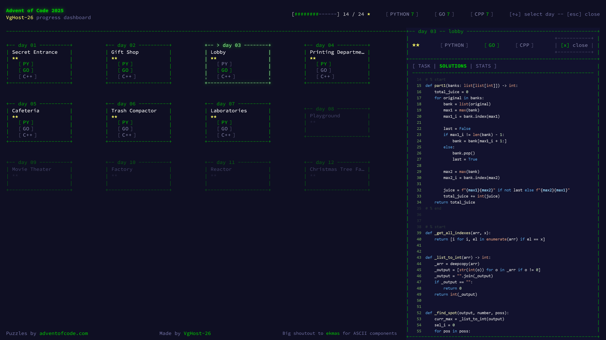
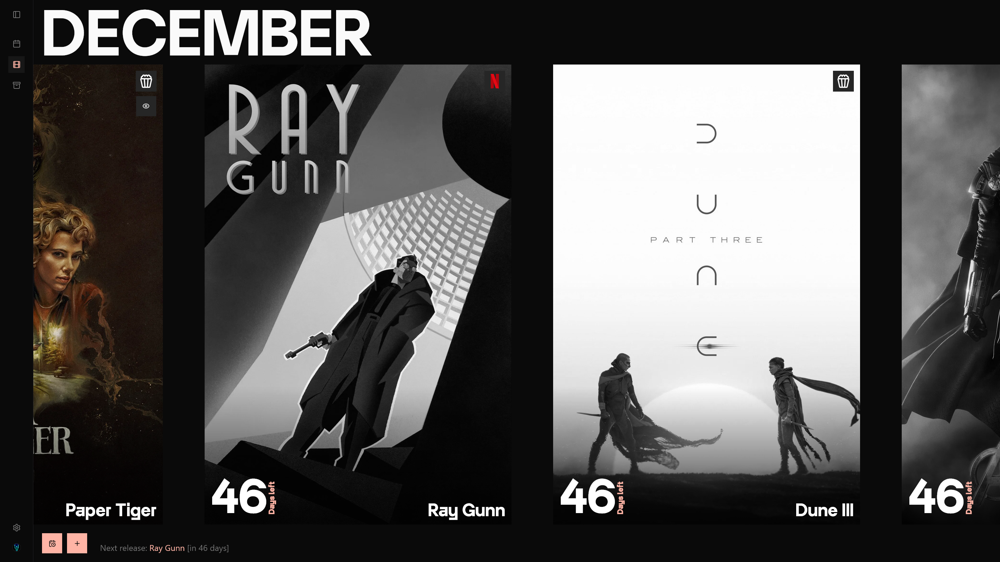

## Check out some of the stuff I made

| **Advent of Code Dashboard**                                                              | Movie Calendar                         |
| ----------------------------------------------------------------------------------------- | -------------------------------------- |
|                             |  |
[vghost-26.github.io/advent-of-code-2025](https://vghost-26.github.io/advent-of-code-2025/) | [**https://movie-calendar-2-0.vercel.app**](https://movie-calendar-2-0.vercel.app/) 
| Progress tracking dashboard for my solutions in Advent of Code with speed benchmark stats | Movie premier tracker to save interesting tittles dates |

<!--
**VgHost-26/VgHost-26** is a ✨ _special_ ✨ repository because its `README.md` (this file) appears on your GitHub profile.

Here are some ideas to get you started:

- 🔭 I’m currently working on ...
- 🌱 I’m currently learning ...
- 👯 I’m looking to collaborate on ...
- 🤔 I’m looking for help with ...
- 💬 Ask me about ...
- 📫 How to reach me: ...
- 😄 Pronouns: ...
- ⚡ Fun fact: ...
-->
